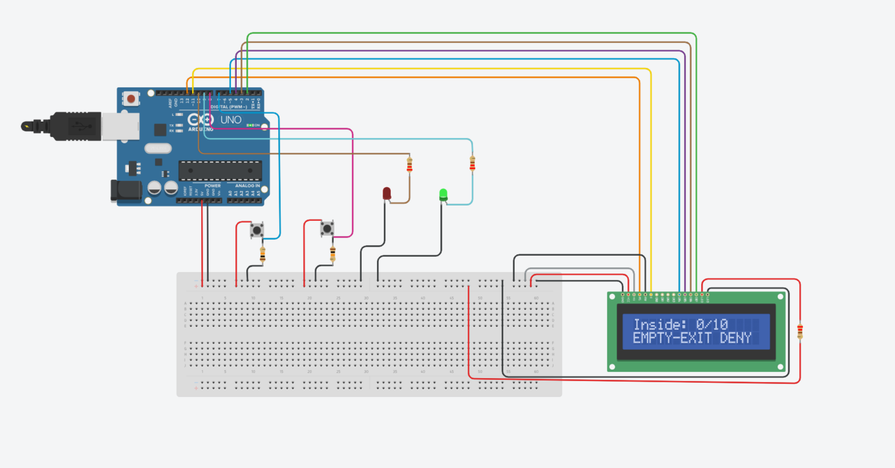

# Smart Occupancy Monitoring and Access Control System

An Arduino Uno project, simulated in Tinkercad. It counts the people inside a facility with a fixed maximum capacity (default **10**, set by `MAX_CAPACITY` in the sketch). One push button records an entry and another records an exit.

**Tinkercad circuit:** [Smart Occupancy System](https://www.tinkercad.com/things/iSLxuJcIeTw-smart-occupancy-system?sharecode=cU35vxw4GfxqkCvoARtxbGzY_TrSu_l6ch357K_rOdc)

## Files

| File | Contents |
|------|----------|
| `SmartOccupancy.ino` | The full sketch. Paste it into the Tinkercad **Code → Text** editor. |
| `screenshots/` | Screenshots of the running simulation |

## Simulation screenshots

**Empty facility.** The LCD shows `Inside: 0/10` and `Available: 10`, and the green LED is on.


**Exit pressed while empty.** The exit is rejected and the LCD shows `EMPTY-EXIT DENY`.



**Facility full.** At `10/10`, an entry attempt is rejected with `FULL-ENTRY DENY`. The red LED is on and the green LED is off.


## Components

| Component | Qty | Notes |
|-----------|-----|-------|
| Arduino Uno R3 | 1 | Main controller |
| Push button | 2 | Entry and exit |
| Green LED | 1 | Capacity available |
| Red LED | 1 | Facility full |
| 16x2 LCD (parallel, not I2C) | 1 | Shows occupancy and remaining capacity |
| 220 Ω resistor | 3 | 2 for the LEDs, 1 for the LCD backlight |
| 10 kΩ resistor | 2 | Pull-down resistors for the buttons |
| Breadboard and jumper wires | – | Circuit assembly |

## Wiring

Connect the breadboard power rails to the Arduino's **5V** and **GND** pins.

### LCD 16x2

| LCD pin | Connect to |
|---------|------------|
| GND (VSS) | GND |
| VCC (VDD) | 5V |
| V0 (contrast) | GND (or the wiper of a 10 kΩ potentiometer) |
| RS | Arduino **D12** |
| RW | GND |
| E | Arduino **D11** |
| DB4 | Arduino **D5** |
| DB5 | Arduino **D4** |
| DB6 | Arduino **D3** |
| DB7 | Arduino **D2** |
| LED anode (A) | 5V through a 220 Ω resistor |
| LED cathode (K) | GND |

### Buttons (with external pull-down resistors)

| Button | Leg 1 | Leg 2 |
|--------|-------|-------|
| Entry | 5V | Arduino **D7**, plus 10 kΩ to GND |
| Exit | 5V | Arduino **D8**, plus 10 kΩ to GND |

The pin reads LOW when the button is released and HIGH when it is pressed. In Tinkercad, place each button across the breadboard's centre gap and use legs on opposite sides.

### LEDs

| LED | Anode (long leg) | Cathode (short leg) |
|-----|------------------|---------------------|
| Green | Arduino **D9** through 220 Ω | GND |
| Red | Arduino **D10** through 220 Ω | GND |

## Behaviour

| Condition | Green | Red | LCD row 2 |
|-----------|-------|-----|-----------|
| 0 people inside | ON | OFF | `Available: 10` |
| Some people inside, below capacity | ON | OFF | `Available: N` |
| Maximum capacity reached | OFF | ON | `FULL - NO ENTRY` |
| Entry attempted when full | OFF | ON | `FULL-ENTRY DENY` (shown for 2 s) |
| Exit attempted when empty | ON | OFF | `EMPTY-EXIT DENY` (shown for 2 s) |

LCD row 1 always shows `Inside: X/10`.

### Serial Monitor (9600 baud)

Every entry, exit and rejected attempt is printed with a timestamp and the new occupancy, for example:

```
[2739 ms] ENTRY  : Person entered. | Inside: 10/10 | Available: 0
[ALERT] Facility is now FULL. Red LED on.
[3247 ms] ERROR  : Entry denied - maximum capacity (10) reached. | Inside: 10/10 | Available: 0
```

Commands you can type into the Serial Monitor:

| Key | Action |
|-----|--------|
| `s` | Print statistics: current, available, utilisation %, peak, total and denied entries and exits |
| `l` | Print the last 10 events |
| `r` | Reset: free all records with `free()`, allocate new ones, and set occupancy to 0 |
| `h` | Print help |

## Where each requirement is met

| Requirement | Implementation |
|-------------|----------------|
| Structures | `OccupancyRecord`, `OccupancyEvent`, `EventLog`, `DebouncedButton`, `DisplayState` |
| Pointers | Every function receives a pointer to the record it reads or changes, e.g. `processEntry(OccupancyRecord *record, EventLog *log)`. The destroy functions take `**` so they can set the caller's pointer to NULL. |
| Dynamic memory | `createOccupancyRecord()` uses `malloc()`. `createEventLog()` uses `malloc()` for the log and `calloc()` for its event buffer. |
| Memory management | Every allocation is checked for NULL. A partially built log is freed. `releaseSystemMemory()` calls `free()` on reset, and allocation failure calls the fatal handler `haltWithError()`. |
| Functions | Entry and exit (`processEntry`, `processExit`), display (`updateLcd`, `printLcdLine`), status (`updateStatusLeds`), and reporting (`printStatistics`, `printEventLog`) |
| Non-blocking | `millis()` is used for the 50 ms debounce (`wasButtonPressed`), the 250 ms LCD refresh (`updateLcd`) and the 2 s denial notice. `delay()` is never called. |
| Error handling | Entry is rejected when full and exit is rejected when empty, both with Serial errors. The code also guards against NULL records and reports unknown Serial commands. |
| Serial communication | Event messages, alerts, statistics and the event log |

## Running in Tinkercad

1. Build the circuit as described in the wiring tables.
2. Open **Code**, switch to **Text**, and replace the default code with the contents of `SmartOccupancy.ino`.
3. Click **Start Simulation** and open the **Serial Monitor**.
4. Click the entry and exit buttons and watch the LCD, the LEDs and the Serial output.
